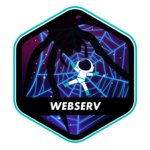
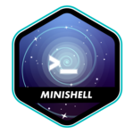
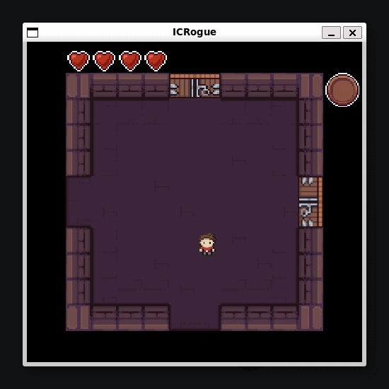

## Hi, I'm Natalino
 

Software engineering student at 42 Lausanne. I started out at EPFL and HEIA, then switched to 42's project-based model, where I learn by building: from a Unix shell and an HTTP server in C/C++ to leading a full-stack web app in production.

### Key Projects

<table>
  <tr>
    <td width="150" align="center">
      
    </td>
    <td>
      <strong>Full-Stack Nutrition App</strong> 
      Led a 5-person team to build and ship <a href="https://catchmeal.ch">CatCHMeal</a>, a nutrition tracker live in production. Defined the architecture, reviewed every module and owned the UI/UX, building the shared components and unifying the whole interface. Also built meal logging and barcode food lookup via Open Food Facts end to end, from React to NestJS. 
      <em>Tech: React, TypeScript, NestJS, PostgreSQL, Docker</em>
    </td>
  </tr>
  <tr>
    <td width="150" align="center">
      
    </td>
    <td>
      <strong>HTTP Server</strong> 
      Built a fully functional, non-blocking HTTP/1.0 server in C++98, following a structured team workflow (feature branches, conventional commits, mandatory PR reviews). Managed socket multiplexing (poll) and CGI execution. 
      <em>Tech: C++, Sockets, HTTP Protocol, Network</em>
    </td>
  </tr>
  <tr>
    <td width="150" align="center">
      
    </td>
    <td>
      <strong>UNIX Shell</strong> 
      Recreated a Bash-like shell from scratch. Built a custom lexer/parser (AST) to handle child processes, pipes, redirections (&lt;, &lt;&lt;, &gt;, &gt;&gt;), logical operators (&&, ||), subshells, and wildcards. 
      <em>Tech: C, AST, POSIX API, Pipes & Redirections</em>
    </td>
  </tr>
  <tr>
    <td width="150" align="center">
      
    </td>
    <td>
      <strong>Roguelike Game</strong> 
      Built a Java roguelike dungeon crawler on a 2D grid engine: procedural level generation, enemies, weapons, and an encapsulated OOP architecture. 
      <em>Tech: Java, OOP, Procedural Generation</em>
    </td>
  </tr>
  <tr>
    <td width="150" align="center">
      
    </td>
    <td>
      <strong>Image Codec (QOI format)</strong> 
      Built a byte-level encoder/decoder for the QOI lossless image format, working with bitwise operators, modular arithmetic, and hash tables. 
      <em>Tech: Java, Bitwise Operations, Hash Tables</em>
    </td>
  </tr>
</table>
